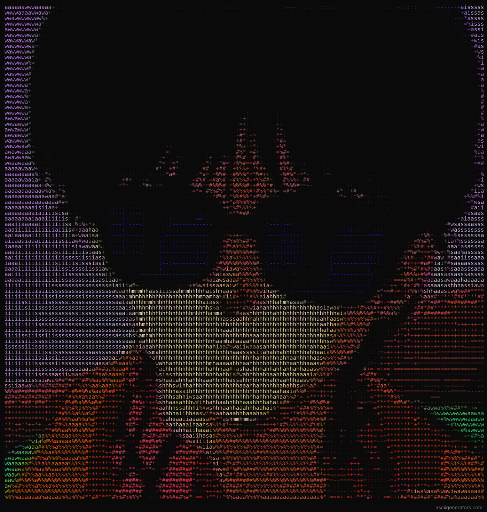

# `awaisAhmed19@github:~$ gitfetch`

<table>
<tr>
<td width="30%" align="center" valign="middle">



</td>
<td valign="middle">

```text
awais@github
-------------------------
OS        : Human 24.0
Host      : Software Engineer
Shell     : fish
Editor    : Neovim
Terminal  : Alacritty
Languages : C, C++, Python
Focus     : Systems Programming
Interests : Graphics, ML, Reverse Engineering
Status    : Always compiling...
```

</td>
</tr>
</table>

```bash
$ whoami
```

I'm Awais Ahmed.

A software engineer fascinated by how things work beneath the surface.

I enjoy taking systems apart, understanding their internals, and rebuilding them from scratch. Mostly in C and C++, occasionally questioning my life choices.

```bash
$ cat /etc/interests
```

- Systems programming and low-level development
- Computer graphics and rendering
- Machine learning from first principles
- Reverse engineering and software archaeology
- Digital painting, animation and creative tools

---

## `~/projects`

| Project | Description | Stack |
|---|---|---|
| [libten](https://github.com/awaisAhmed19/libten) | Standalone tensor library with CPU and optional CUDA backends | C11, CUDA |
| [TinyTTS](https://github.com/awaisAhmed19/Tiny_TTS) | Neural network-based text-to-speech experimentation | C++, CUDA |
| [LXPaint](https://github.com/awaisAhmed19/LXPaint) | CPU-rendered 2D painting application | C++, SDL3, ImGui |
| [RetroMSPaint](https://github.com/awaisAhmed19/RetroMSPaint) | Recreating the classic MS Paint experience | React, MERN |

---

## `~/toolchain`

```text
Languages
  C · C++ · Python · JavaScript · TypeScript

Graphics
  SDL3 · OpenGL · Raylib · ImGui

Systems
  Linux · Git · CMake · Docker

Development
  Neovim · GCC · GDB · CUDA

Creative
  Krita · Aseprite · Blender
```


---

## `~/connect`

[GitHub](https://github.com/awaisAhmed19) · [LinkedIn](https://www.linkedin.com/in/awais-ahmed-679876222)

```bash
awais@github:~$ echo "Thanks for stopping by."
Thanks for stopping by.

awais@github:~$ _
```
